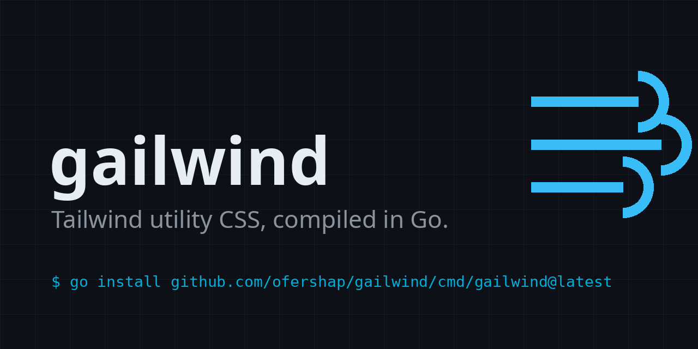

# gailwind



**Your Go web app uses Tailwind classes, and now your CSS build step depends on fetching a platform binary - or installing Node in a Go pipeline.**

gailwind compiles Tailwind v3 utility CSS from your Go source files with a pure-Go engine. Import it as a **library** in your templ handler, code generator or build tool, or `go install` the **CLI**. One dependency, managed by `go` itself.

```console
$ gailwind -o app.css './templates/**/*.templ' './web/**/*.html'
$ gailwind -minify -strict -o app.css index.html
```

```css
/* app.css starts with the real v3.4.19 preflight, then only the utilities you used: */
*, ::before, ::after {
  --tw-border-spacing-x: 0;
  ...
}
.hover\:bg-blue-600:hover {
  --tw-bg-opacity: 1;
  background-color: rgb(37 99 235 / var(--tw-bg-opacity, 1));
}
```

Classes gailwind can't compile are printed to stderr, never silently dropped. `-strict` turns that into a failed build, so your pipeline breaks loudly instead of shipping unstyled markup.

## Install

CLI:

```sh
go install github.com/ofershap/gailwind/cmd/gailwind@latest
```

Library:

```sh
go get github.com/ofershap/gailwind
```

```go
css, report := gailwind.Generate(source1, source2)
// report.Unknown lists class-attribute tokens gailwind did not generate
```

## What it does

- Compiles the Tailwind **v3.4.19 default-theme core utility set**: layout, spacing, sizing, flex/grid, typography, colors, borders, effects, transforms, interactivity, transitions and animations.
- Variants: pseudo-classes (`hover`, `focus-visible`, `first`...), `group`/`peer`, `sm`-`2xl`, `dark`, orientation, motion and print.
- Arbitrary values: `w-[17px]`, `bg-[#bada55]`.
- Includes the real v3.4.19 **preflight** (embedded verbatim, Tailwind Labs, MIT - see `licenses/`) and the **container** component, so output matches `@tailwind base; @tailwind components; @tailwind utilities;`. `-no-preflight` opts out.
- Orders rules the way v3 does, so cascade behavior matches what Tailwind produces for the same classes.

## What it doesn't do

- **Not a full Tailwind port.** No plugins, no custom themes or config files, no `@apply`. Gradients, filters, `space-*`/`divide-*`, and `ring` color/offset sub-utilities are not implemented.
- Class-based dark mode is out; `dark:` compiles to `@media (prefers-color-scheme: dark)`, v3's default.
- The fidelity numbers below cover gailwind's implemented-feature corpus, not a percentage of Tailwind.

## Measured fidelity

Verified against the real `tailwindcss@3.4.19` CLI, not self-reported:

- **290/290 rules - 100% declaration match, 0 order inversions** on the implemented-feature corpus (`testdata/corpus.html`, ~200 classes across every implemented family, including variant stacks, negatives and arbitrary values). Reproduce with `parity/parity.py`.
- **Real-template check:** on the unmodified [tailwindtoolbox Landing-Page](https://github.com/tailwindtoolbox/Landing-Page), gailwind's full output (preflight + container + utilities) matches the real v3.4.19 build on **206/206 flattened rules - 100% declaration match**. Of 169 class-attribute candidates, 160 generated; the 9 reported unknowns are v2-era classes real v3.4.19 doesn't generate either, plus the template's own custom classes. Element-anchored side-by-side renders are visually identical.

## How it works

1. **Extract** candidate classes from source text (Tailwind-style candidate regex).
2. **Compile** each candidate against the embedded v3.4.19 default theme into the same declarations v3 emits, including its `rgb(R G B / var(--tw-*-opacity, 1))` color form, `--tw-shadow` triplets, vendor-prefixed fallbacks and keyframes.
3. **Order** rules the way v3's variant offsets order them (verified empirically against probe outputs).

## Q&A

<details><summary><b>How do I use Tailwind CSS with Go and templ?</b></summary>
Point gailwind at your <code>.templ</code> and <code>.html</code> files and write the output to your static directory. The official Tailwind CLI already ships a standalone binary; gailwind is for when you want the compiler as a Go library inside your own tooling, or a CLI installed and pinned by <code>go install</code> like the rest of your Go tools.</details>

<details><summary><b>Can I generate Tailwind CSS without Node?</b></summary>
Yes. gailwind's engine, CLI and tests are pure Go. (Development used the official CLI once to generate reference fixtures; the shipped code embeds the results with license and provenance.)</details>

<details><summary><b>Is gailwind a full Tailwind replacement?</b></summary>
No. It is the v3.4.19 default-theme core utility set with the variants listed above, measured against the real CLI on its implemented-feature corpus. No plugins, custom themes or <code>@apply</code>. If you need the full framework, use the official Tailwind CLI.</details>

<details><summary><b>What happens when I use a class gailwind doesn't know?</b></summary>
It is printed to stderr and skipped; <code>-strict</code> exits 1. Unknown detection only flags tokens you actually wrote in a <code>class</code> attribute, so SVG path data and prose don't produce noise.</details>

<details><summary><b>Does it watch files?</b></summary>
No <code>-watch</code> flag; re-run the command. It's pure Go with no startup tax, so re-runs are fast.</details>

<details><summary><b>Can I use my own theme?</b></summary>
No. The v3.4.19 default theme is the contract.</details>

## Contributing

Issues and PRs welcome - see [CONTRIBUTING.md](CONTRIBUTING.md). Please report security issues privately per [SECURITY.md](SECURITY.md).
---

More projects: [gitshow](https://github.com/ofershap/gitshow) · [real-browser-mcp](https://github.com/ofershap/real-browser-mcp) · [cursor-usage-tracker](https://github.com/ofershap/cursor-usage-tracker) · [mcp-server-markdown](https://github.com/ofershap/mcp-server-markdown) · [readme-builder](https://github.com/ofershap/readme-builder) · [grok-bot-skills](https://github.com/ofershap/grok-bot-skills) · [mashov-parent-brief](https://github.com/ofershap/mashov-parent-brief)

---

## Author

[](https://gitshow.dev/ofershap)

[](https://linkedin.com/in/ofershap)
[](https://github.com/ofershap)
[](https://ofershap.github.io/)

---

<sub>README built with [README Builder](https://ofershap.github.io/readme-builder/)</sub>

## License

[MIT](LICENSE) &copy; [Ofer Shapira](https://github.com/ofershap) The embedded Tailwind v3.4.19 preflight is MIT, Tailwind Labs - see [licenses/](licenses/).
